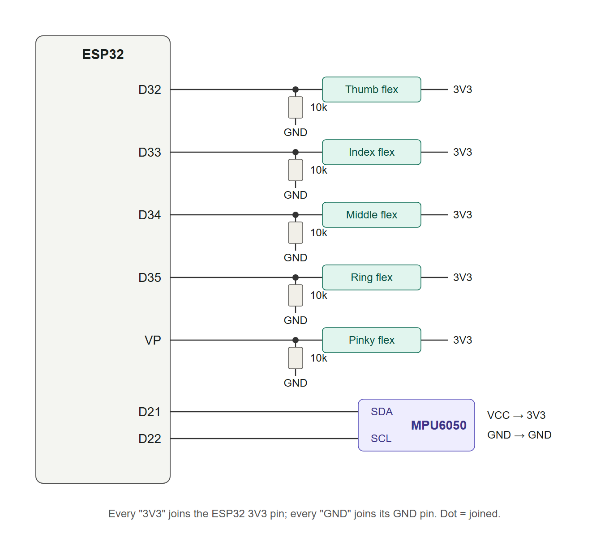
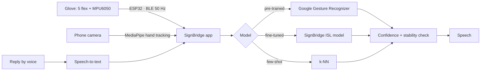

# SignBridge

**Indian Sign Language to speech, in real time, on a phone.** SignBridge reads right-hand ISL signs, from a phone camera or a sensor glove, and speaks them aloud. The hearing person replies by voice, and their words appear as large text. All recognition runs on the device. No video leaves it.

> IoT & Robotics Foundation Lab (CSE25309) project · ESP32 · Bluetooth LE · MediaPipe · transfer learning · Web app

**▶ Try it live: https://sathvikasingoti.github.io/SignBridge/** (Chrome; allow the camera)



## What it does

- **Two inputs, one app.**
  - **Phone camera:** Google's MediaPipe tracks 21 points on the hand.
  - **Sensor glove:** 5 flex sensors and an MPU6050 on an ESP32, sent over Bluetooth LE at 50 Hz.
- **Three recognition models:**
  1. **Google's pre-trained Gesture Recognizer.** Works with no training; each gesture is mapped to a phrase.
  2. **SignBridge fine-tuned ISL model.** The same Google model, fine-tuned on our own right-hand ISL signs (transfer learning).
  3. **k-NN on your recordings.** Learns a new sign from a handful of examples, and works for the glove too.
- **Speaks only when sure:** a confidence threshold plus 4 matching predictions in a row before it speaks anything.
- **Two-way conversation:** text-to-speech for the signer, speech-to-text (English or Hindi) for the reply.
- **Built-in dataset tools:**
  - a guided recording session;
  - a photo dataset export for fine-tuning;
  - a leave-one-out accuracy test with a confusion matrix.
- **Right-hand-only tracking:** a second hand in view is ignored.

## How it works



## Quick start

**Use the app:**
- **On a laptop:** double-click `start-signbridge.bat`, then open http://localhost:8766 in Chrome or Edge.
- **On a phone:** open https://sathvikasingoti.github.io/SignBridge/ in Chrome. It redeploys on every push to `main`.

Press **Use camera**, then **Start recognising**. Thumbs up says "Yes", open palm says "Stop", and so on. You can change what each gesture says in the Talk tab.

**Fine-tune on your own signs:**
1. **Record:** Train tab → *Guided dataset session* with the camera. Record each sign 30+ times, plus "rest".
2. **Export:** Data → *Download photo dataset (.zip)*.
3. **Train:** open [`ml/finetune_gesture_recognizer.ipynb`](ml/finetune_gesture_recognizer.ipynb) in Google Colab, upload the zip, and run all cells.
4. **Use it:** put the downloaded `signbridge_gestures.task` in `app/models/` and choose *SignBridge fine-tuned ISL model*.

**Evaluate in Python:**

```bash
pip install -r ml/requirements.txt
python ml/train.py signbridge-data-*.json        # k-NN vs Random Forest, 5-fold CV, confusion matrices
```

**Flash the glove:** open `firmware/signbridge_glove/signbridge_glove.ino` in Arduino IDE or arduino-cli. Use the board *ESP32 Dev Module* and upload at 115200 baud. Wiring is in [the build guide](docs/build-guide.html).

## Hardware

| Part | Qty | Pin |
|---|---|---|
| ESP32 DevKit V1 (CH340) | 1 | – |
| Spectra Symbol 2.2" flex sensor | 5 | D32 thumb, D33 index, D34 middle, D35 ring, VP pinky |
| 10 kΩ resistor (47 kΩ recommended) | 5 | pin → GND |
| MPU6050 (GY-521) | 1 | SDA D21, SCL D22 |

Each finger is a voltage divider read by the ESP32's ADC1 pins (ADC2 stops working while Bluetooth is on).

The firmware takes a trimmed mean of 16 reads per sample and smooths adaptively. That holds a resting finger steady but lets real bends through quickly. The app's *Re-zero* button corrects flex-sensor creep.

## Repository

| Folder | Contents |
|---|---|
| `app/` | The web app (single page, no build step) and `models/` |
| `firmware/` | ESP32 glove firmware, Tinkercad practice sketch |
| `ml/` | `train.py` (k-NN / Random Forest evaluation), Colab fine-tuning notebook |
| `data/` | How the dataset is made; raw exports stay out of git |
| `docs/` | Build guide, circuit diagrams, project notes |
| `report/` | Project report |
| `tools/` | Serial-port testing scripts for the glove |

## Results

Accuracy figures will be added here after the dataset is recorded. They'll come from the fine-tuning notebook's held-out test set and from `train.py`'s 5-fold cross-validation.

## Limitations

- **Single, isolated signs** from the right hand; no continuous sentences.
- **Camera accuracy** depends on lighting and distance.
- **Google's pre-trained model** knows 7 everyday gestures, not ISL. The fine-tuned model is what recognises ISL.
- **Flex sensors** drift and differ from unit to unit; calibrate before use.

## License

MIT. Hand tracking and the base gesture model are Google's MediaPipe (Apache 2.0).
