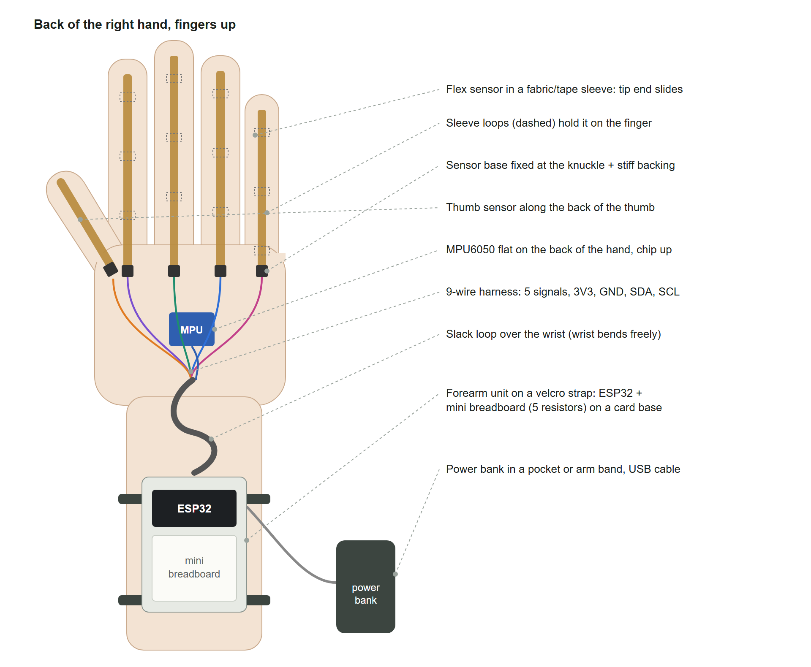
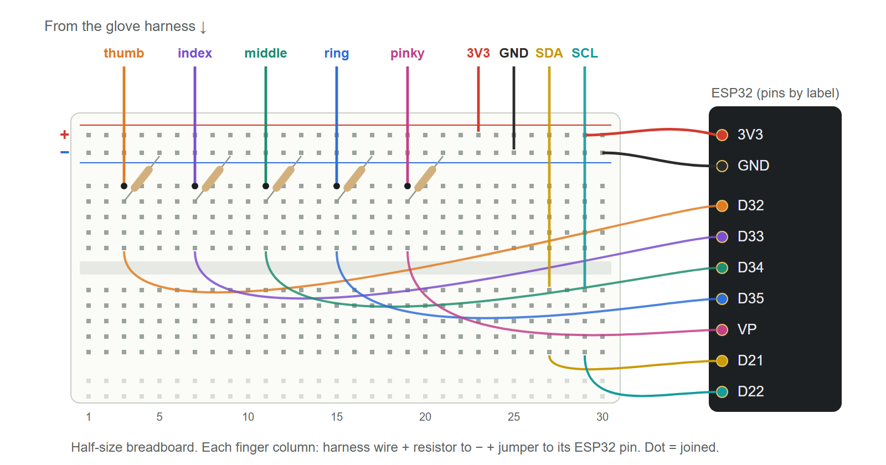

# Glove assembly: from breadboard to wearable

How to move SignBridge off the table and onto the arm:
- the **5 flex sensors** sit on the backs of the fingers;
- the **MPU6050** sits on the back of the hand, so it measures the hand's tilt and movement;
- the **ESP32**, the resistors and a power bank ride on a **forearm unit**.

The circuit is the same as on the breadboard. Only the layout changes.

## Parts

| Part | Qty | Notes |
|---|---|---|
| Spectra Symbol 2.2" flex sensor | 5 | Already wired with extension leads |
| MPU6050 board (GY-521) | 1 | |
| ESP32 DevKit V1 | 1 | |
| Resistors, 10 kΩ (or 47 kΩ, better for these sensors) | 5 | All the same value |
| Half-size breadboard (400 points) | 1 | The full-size one works too, it's just bigger on the arm |
| Thin multi-core wire or rainbow ribbon cable | about 9 × 40 cm | For the harness from hand to forearm |
| Female-to-male jumpers | 9 | From the breadboard to the ESP32 pins |
| Snug thin glove (cotton or nylon) | 1 | Right hand |
| Velcro strap, about 3 cm wide | 1–2 | Holds the forearm unit |
| Stiff card or foam board | about 10 × 8 cm | Base for the forearm unit |
| Power bank + USB cable | 1 | The cable must carry data/power for the ESP32 (micro-USB or USB-C) |
| Heat-shrink, cloth tape, double-sided foam tape, hot glue, zip ties, needle and thread | | |
| A strip of plastic (e.g. from an old card) | 5 small pieces | Stiffener behind each sensor's base |

## Wiring overview

Nine wires run from the hand to the forearm unit:

| Harness wire | From | To (forearm breadboard) | Then to ESP32 |
|---|---|---|---|
| 3V3 common | one leg of every flex sensor + MPU VCC | + rail | 3V3 → + rail |
| GND | MPU GND | − rail | GND → − rail |
| Thumb | thumb sensor's other leg | column 3 | D32 |
| Index | index sensor's other leg | column 7 | D33 |
| Middle | middle sensor's other leg | column 11 | D34 |
| Ring | ring sensor's other leg | column 15 | D35 |
| Pinky | pinky sensor's other leg | column 19 | VP (GPIO 36) |
| SDA | MPU SDA | column 27, bottom half | D21 |
| SCL | MPU SCL | column 29, bottom half | D22 |

Each finger column also has a **resistor from that column to the − rail**. That makes the voltage divider, the same as before.

Electrically this is identical to [the schematic](images/diagrams/circuit-schematic.png). The sensors' 3V3 legs are joined at the hand into one wire, so the harness has 9 wires instead of 14.

## Step by step

### 1. Test before you glue anything (15 min)

1. Wire the forearm breadboard as in the table, with the sensors still loose on the desk. Leave the MPU off for now.
2. Flash the firmware (`firmware/signbridge_glove`, board *ESP32 Dev Module*, upload speed 115200).
3. Open the app → **Connect glove** → **Glove setup**.
4. Bend each sensor one at a time and check that **only its own bar moves**. If the wrong bar moves, swap the wires now. It's much harder once they're on the glove.
5. **Find each sensor's working direction.** Bend it one way, then the other. One direction changes the number a lot more. Mark that side with a pen ("this side out"). On the glove, that side goes on the outside of the bend, facing away from the finger.

### 2. Prepare the sensors (20 min)

1. On every sensor, cover the joint between the metal tabs and the wire with heat-shrink or tape. **This joint is where flex sensors break.**
2. Tape a small piece of stiff plastic behind the tab end, about 1.5 cm long. The base then can't bend, so only the striped sensing part does.
3. Join the "3V3" leg wires of all 5 sensors into one wire, either soldered and heat-shrunk or with a small screw terminal. Leave about 10 cm from each sensor to the join, so it can sit on the back of the hand.
4. Label each signal wire with tape: T, I, M, R, P.

### 3. Make the sleeves on the glove (30 min)

Wear the glove while you mark, then take it off to sew or glue.

1. With a marker, draw a line along the back of each finger, from the knuckle to about 1 cm before the fingertip. Draw the thumb's line along the back of the thumb.
2. Along each line, make **3 small loops** to hold the sensor. Use any of these:
   - stitched strips of fabric;
   - small loops of cloth tape folded sticky-side in, then stitched or glued at the ends;
   - cut-up drinking straws glued on with fabric glue.
3. The loops must be loose enough for the sensor to **slide**. When the finger bends, its back gets longer, and a sensor glued along its whole length gets stretched and creeps.

### 4. Mount the sensors (15 min)

1. Slide each sensor into its loops, marked side out, with the **base (wire end) at the knuckle**.
2. Fix **only the base** to the glove: a stitch through the glove around the stiffener, or hot glue on the stiffener only. The tip end stays free.
3. Fix each sensor's wires to the glove about 2 cm behind the base (a stitch or tape). A tug on the wire then pulls the glove, not the fragile joint.

### 5. Mount the MPU6050 on the back of the hand (10 min)

1. Glue a piece of stiff card (about 3 × 3 cm) onto the back of the glove, over the middle of the back of the hand. The fabric there bends, and the card stops the chip rocking.
2. Stick the MPU on the card with double-sided foam tape: **flat, chip side up, pin row facing the wrist**. Always the same way round, because the model learns its orientation.
3. Solder or connect 4 wires to VCC, GND, SDA and SCL. Leave XDA, XCL, AD0 and INT unconnected.
4. Join MPU **VCC** to the sensors' 3V3 common wire. Its other 3 wires join the harness.
5. Keep the SDA and SCL wires **under about 40 cm** and away from the flex signal wires. Twisting SDA with GND, and SCL with 3V3, keeps the link reliable.

### 6. Route the harness (10 min)

1. Bundle all 9 wires (5 signals, 3V3, GND, SDA, SCL) on the back of the hand. Tape or zip-tie them to the glove at 2–3 points.
2. Leave a **slack loop over the wrist** (about 5 cm extra), so bending the wrist never pulls a wire.
3. Run the bundle along the forearm to the forearm unit.

### 7. Build the forearm unit (20 min)

1. Stick the half-size breadboard and the ESP32 side by side on the card base, with double-sided tape. The ESP32 stays off the breadboard and connects through female-to-male jumpers, as before.
2. Wire the board as in the diagram:
   - ESP32 **3V3 → + rail** (3V3 is the corner pin at the USB end, **not VIN**), and ESP32 GND → − rail;
   - 5 resistors, one from each finger column to the − rail;
   - harness wires into their columns and rails;
   - jumpers from the columns to D32, D33, D34, D35, VP, D21 and D22.
3. Thread the velcro strap under the card, or hot-glue the card onto the strap. Strap it to the forearm, about 5 cm below the wrist, ESP32 facing up.
4. Plug the USB cable from the power bank into the ESP32. Put the power bank in a pocket or arm band.

Some power banks switch off when the load is very small. The ESP32 with Bluetooth on usually draws enough to keep it awake, but if the glove disconnects after about 30 seconds, try a different power bank.

### 8. Check it works (10 min)

1. Open the app → **Connect glove** → **Glove setup**.
   - The status should show **49–50 packets/s**.
   - The motion line should **not** say "MPU6050 not found".
2. Tilt your hand palm-down, then palm-up. The accel values should clearly change sign: about +1 g becomes about −1 g on one axis.
3. Bend each finger. Its own bar should move, and the others should stay still.
4. Press **Calibrate**: open hand, then fist. Every finger should calibrate without the "barely changed" warning.
5. If you used the PC instead (`tools/live.ps1`), you see the same numbers in a terminal.

### 9. Record and use

1. Train tab → **Guided dataset session**, with the glove connected: 6–8 right-hand signs, 20–30 each, plus rest.
2. Press **Re-zero open hand** at the start of each session. Flex sensors creep, so their resting values shift a little.
3. **Run test** shows the glove's accuracy. Export the data for `ml/train.py`.

## Troubleshooting

| Symptom | Likely cause |
|---|---|
| A finger reads 0 all the time | Its signal or 3V3 wire is broken. The joint at the sensor tabs is the usual spot. |
| A finger reads about 4095 all the time | Its resistor doesn't reach the − rail, or the signal wire touches 3V3 |
| A finger jumps around randomly | Its jumper is one column off, so the ESP32 pin is connected to nothing |
| Bending one finger moves another bar | Two signal wires are swapped. Re-check with step 1.4. |
| A finger changes very little | It's bent the wrong way or only at the base, or try 47 kΩ resistors |
| "MPU6050 not found" | VCC/GND not reaching the MPU, SDA/SCL swapped, or the wires are too long |
| Glove disconnects when you move | A loose jumper on the forearm unit. Tape the jumpers down. |
| Values drift during a session | Normal flex-sensor creep. Press Re-zero open hand. |
